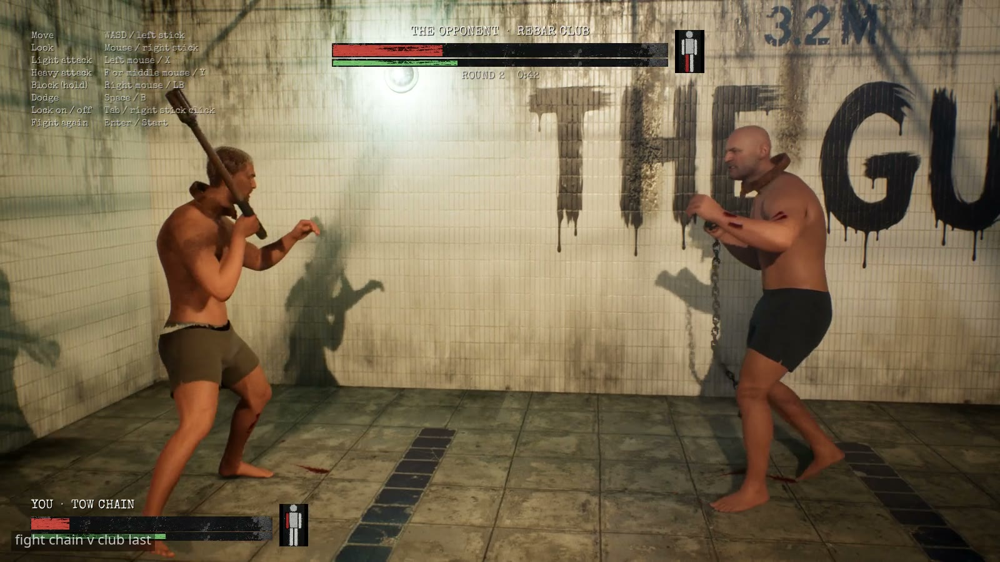
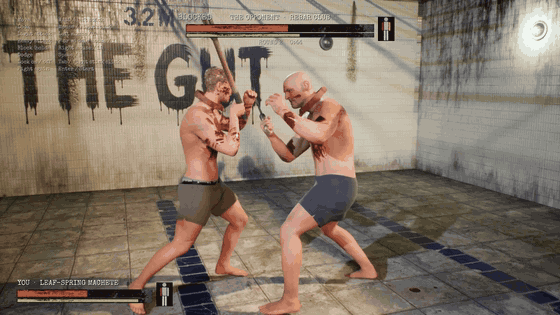
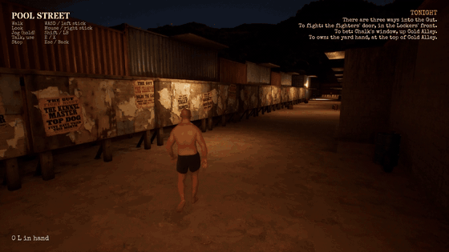
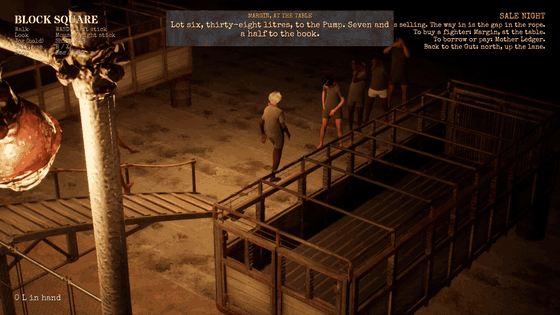
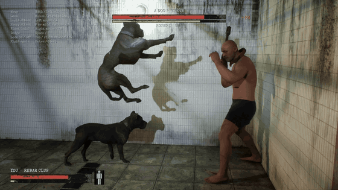
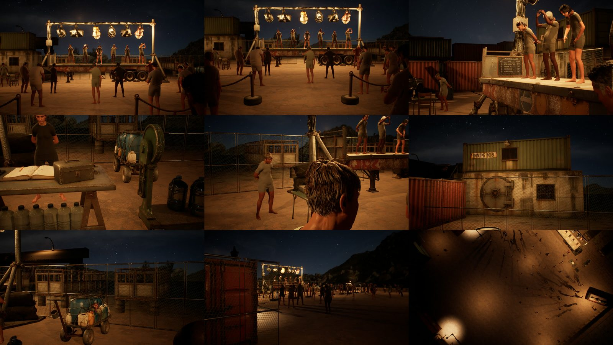
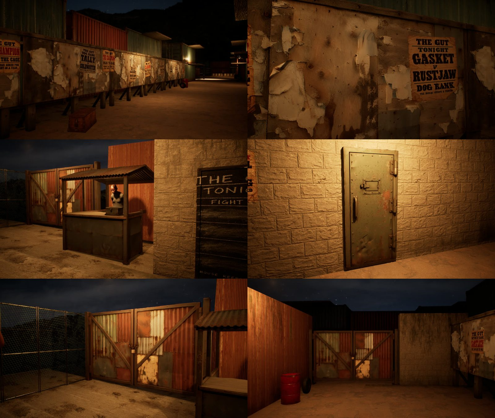
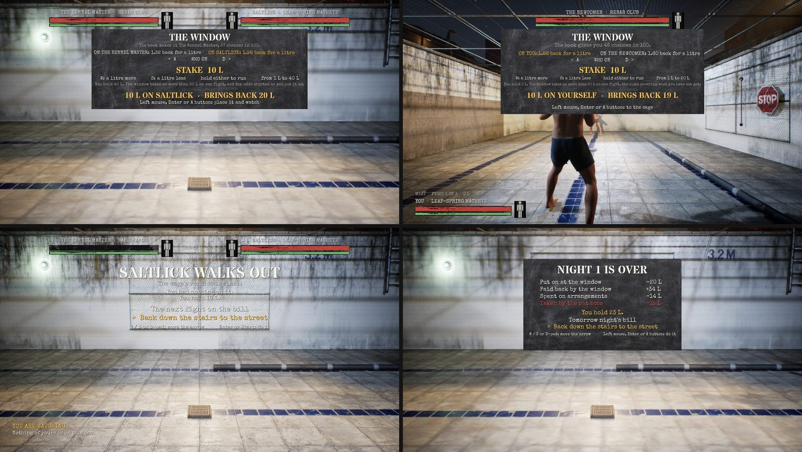
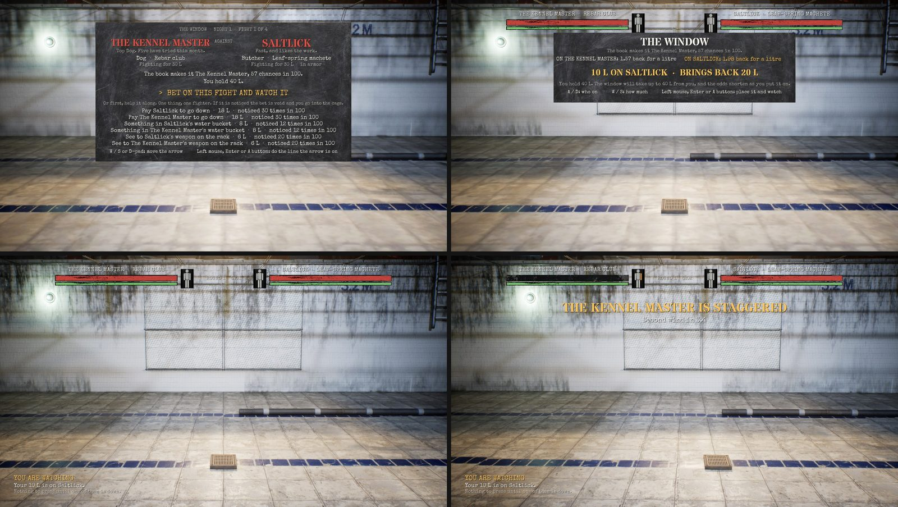
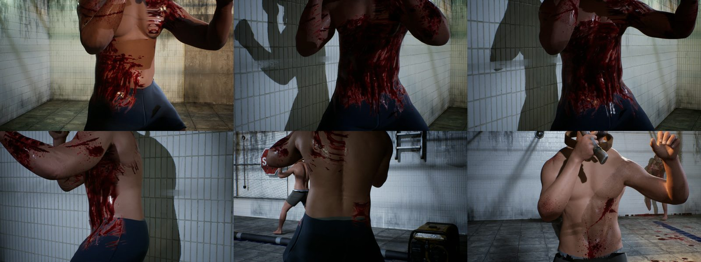

# Ashmarket

-red)

> [!WARNING]
> **🚧 This is a work in progress.** Ashmarket is an early prototype that changes daily. Nothing has been released, there are no builds to download, and **the game can't be played from this repository**: the art, levels, characters and sounds aren't included (see [What's in this repository](#whats-in-this-repository)). Expect rough edges, placeholder pieces and things that break.

> [!CAUTION]
> **Adults only.** Ashmarket is set in a town that trades in people. It has graphic violence and blood, and slavery is part of the setting. Every character is an adult.

A single-player, third-person action RPG built in Unreal Engine 5. Ashmarket is a market town on the floor of a drained reservoir in the desert Southwest, forty years after the collapse. It holds the only deep well for 200 miles, so water is money and everything, people included, has a price. You start as property. You might end as a liberator, a warlord or the head slaver.

The first piece being built is **the Gut**: the town's fighting cage, a drained swimming pool where debts are settled in blood. Around it, the first streets of the town are going up.

## Watch it

The films were recorded from the game by its own test tools. Click a loop to get the full film (MP4, with sound).

| | |
| :-- | :-- |
|  **[A fight in the Gut](https://github.com/VincentAZ/Ashmarket/releases/download/wip-media-2026-11/ashmarket-fight_blows_that_land.mp4)** (1:15) |  **[Walking Pool Street](https://github.com/VincentAZ/Ashmarket/releases/download/wip-media-2026-11/ashmarket-walk_pool_street.mp4)** (0:42) |
|  **[Sale night on Block Square](https://github.com/VincentAZ/Ashmarket/releases/download/wip-media-2026-11/ashmarket-sale_on_the_block.mp4)** (1:06) |  **[Against the dogs](https://github.com/VincentAZ/Ashmarket/releases/download/wip-media-2026-11/ashmarket-fight_against_the_dogs.mp4)** (0:52) |

More films:

- **[Tonight in three minutes](https://github.com/VincentAZ/Ashmarket/releases/download/wip-media-2026-11/ashmarket-tonight_in_three_minutes.mp4)** (2:27): a cut of a night's fights, dogs, hazards and finishers
- **[A fight with the crowd shouting](https://github.com/VincentAZ/Ashmarket/releases/download/wip-media-2026-11/ashmarket-fight_with_the_crowd_shouting.mp4)** (1:11)
- **[Two on two](https://github.com/VincentAZ/Ashmarket/releases/download/wip-media-2026-11/ashmarket-fight_two_on_two.mp4)** (1:21)

All of them are on the [work-in-progress media release](https://github.com/VincentAZ/Ashmarket/releases/tag/wip-media-2026-11).

## Screenshots

**Block Square on a sale night.** Lots are called from a flatbed trailer under a gantry of work lamps, a clerk weighs out water at the table, and the crowd bids from behind the rope.

**Pool Street.** The Hoarding and its fight bills, the betting window up the alley, the fighters' door and the chained gates.

**The window.** Bet on the night's card in litres of water, or pay to help a fight along and hope nobody notices.

**Wounds stay where they land.**

## What's built so far

Everything here works in the prototype today, but none of it is finished.

- **The Gut.** One-on-one cage fights with light and heavy attacks, blocking, dodging, stamina, staggers and finishers. Bare hands or four weapons made from the old world's scrap (a rebar club, a leaf-spring machete, a tow chain and a stop-sign shield), picked from a rack before the fight. Spikes and a live cable switch on mid-fight. There are fights against dogs, two on two and one against three, wounds and blood that stay on bodies, and a crowd that shouts.
- **Three ways in.** Fight your way up a ladder of opponents as a fighter. Bet on the night's card at the window. Or come in as an owner: buy fighters, train them and send them in.
- **Pool Street.** The first part of the town you can walk: the Lockers' front, Cold Alley, the betting window, people to talk to, and the doors into the Gut.
- **Block Square.** A sale night with sixty-six people: lots called and sold from the Block, a clerk who sells you fighters, and Mother Ledger, who lends you water and remembers it.
- **Tests.** Automated tests cover the fights, the ladder, the window and the town, and run with or without a window.

## What isn't built yet

The design document describes a whole town and the wasteland around it. Most of that is still on paper:

- [x] The Gut: fights, weapons, hazards, dogs, the ladder, the window, the stable
- [x] Pool Street (milestone 7)
- [ ] Block Square (milestone 8): built and dressed; clothes and the crowd's recorded lines still to come
- [ ] Main Street (milestone 9)
- [ ] Better fighter motion, real two-person finishers, clothes beyond one pair of shorts
- [ ] The five factions, faction standing, heat (the wanted system) and the drought
- [ ] The wasteland: the Flats, the Bones and the Kiln
- [ ] Quests, characters and endings
- [ ] A build anyone else can play

## What's in this repository

This repository holds the project's **text**: the C++ game code, the build and tool scripts, the engine config and the design notes. The binary parts stay out because they're large, can't be merged, and are mostly made again by the tools. That includes the Unreal content (levels, characters, animation, materials, sounds), the source art and every film and picture apart from the few in [`docs/media/`](docs/media/). **You can read the code, but you can't open or run the game from a clone.**

| Path | What it is |
| :-- | :-- |
| [`Source/Ashmarket/Gut/`](Source/Ashmarket/Gut/) | The cage: fighters, weapons, the ladder, the window, the stable, the HUD and their tests |
| [`Source/Ashmarket/Town/`](Source/Ashmarket/Town/) | Pool Street and Block Square: walking, talking, doors, the sale and their tests |
| [`Tools/`](Tools/) | Build, test, film and import scripts, plus the Python that builds levels and imports art, motion and sound |
| [`ASHMARKET — Game Design Document.docx.md`](ASHMARKET%20%E2%80%94%20Game%20Design%20Document.docx.md) | The design document: world, factions, the Market Law, systems |

## Building

These notes are for reading along. Without the content folder the project compiles but has nothing to show.

- Unreal Engine 5.9 built from source on Linux, at `~/UnrealEngine/UE_5.9` (or set `UE_ROOT`)
- `Tools/build.sh` compiles the game module for the editor
- `Tools/run_gut_tests.sh` runs the automated tests
- `Tools/play_gut.sh` starts the game in its own window. `GUT_MODE=ladder`, `window`, `stable`, `square` or `sandbox` go straight to one part of it

## Made with

Unreal Engine 5.9 and MetaHuman for the fighters. Scene models were made in Mixar and motion was generated with Kimodo. Every sound is a CC0 recording from freesound.org. Most of the code was written with [Claude Code](https://claude.com/claude-code).

## License

The original game code is free and open source under the [MIT License](LICENSE), copyright © 2026 Vincent Serpico. Use it, modify it, redistribute it, or build on it; keep the copyright and permission notice with copies or substantial portions of the code.

The art and content folder is not included in this repository. Unreal Engine, MetaHuman, and the freesound.org recordings keep their own terms; this MIT grant does not relicense them.
